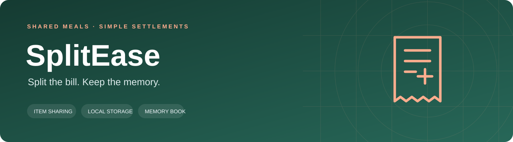
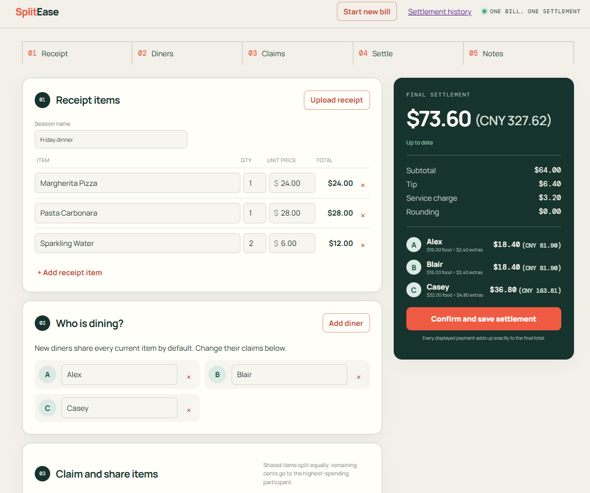
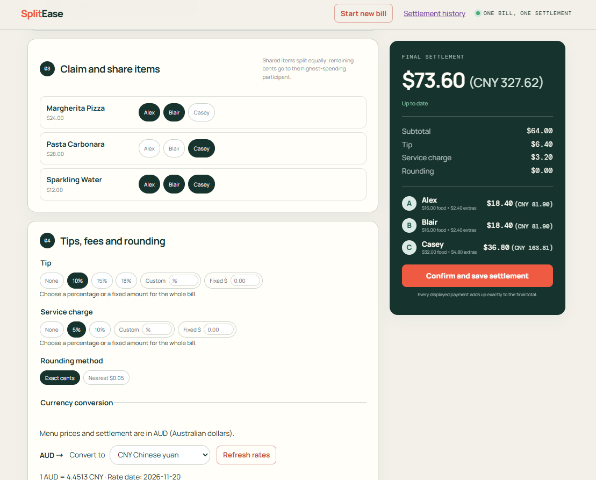
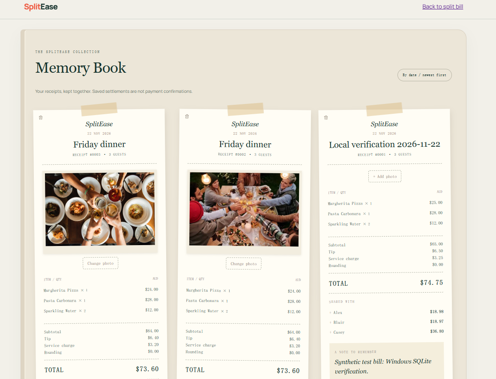

<div align="center">



**Split the bill. Keep the memory.**

[English](README.md) · [简体中文](README.zh-CN.md)


</div>

---

SplitEase helps you share a restaurant bill: enter receipt items, choose who shares each dish, and add tips or service charges to calculate what everyone owes. Saved bills become a Memory Book, with optional photos and notes.

The current Windows x64 portable version uses React, FastAPI, and SQLite. Its EXE bundles the Python runtime and built frontend, so users do not need to install Python, Node.js, or a database server. The interface opens in the system browser.

> Windows download: [Latest release](https://github.com/BenjaminW5/split_easy/releases/latest). Download the portable ZIP, extract it, and double-click SplitEase.exe.

## Screenshots

### Bill editor and live settlement

Edit item names, quantities, prices, and diners. The summary updates the bill total and each person's share.



### Item claims, tips, and service charges

Choose who shares each dish, set percentage or fixed charges, and select exact-cent or nearest-AUD-0.05 rounding.



### Memory Book

Browse saved items, charges, individual shares, and notes. Add photos to remember the meal.



The screenshots show demonstration bills. Exchange rates and converted amounts reflect the values displayed when the screenshots were taken.

## Features

- **Receipt items:** add, edit, and remove items with quantities and unit prices.
- **Diners:** add, rename, and remove participants.
- **Item-based sharing:** assign each dish to one or more diners.
- **Charges and rounding:** percentage or fixed tips and service charges, plus cash rounding.
- **Live totals:** see food costs, additional charges, and final payments per person.
- **History and photos:** save bills, notes, and photos; browse or delete saved records.
- **Reference conversion:** display CNY, USD, EUR, JPY, or KRW equivalents of AUD amounts.
- **Local storage:** keep bills in SQLite without an account.

## Run the Windows portable version

1. Extract the locally supplied `SplitEase-Windows-x64.zip`, or use `SplitEase.exe` directly.
2. Double-click `SplitEase.exe` and wait for the browser to open.
3. Keep the application's console window open while using the interface.
4. Close the console window to stop the local service. Closing only the browser tab does not stop it.

The application listens only on `127.0.0.1` and selects an available port automatically. You do not need to start a backend or Vite separately. Avoid running multiple instances at once.

If the browser does not open automatically, copy the address shown in the console. The latest startup address is also recorded in `%LOCALAPPDATA%\SplitEase\last-url.txt`.

### Split a bill

1. Select **Start new bill** and confirm clearing the current editor. Previously saved bills are kept.
2. Add diners, name the bill, and enter receipt items.
3. Under **Claim and share items**, select the diners sharing each dish. Every item needs at least one participant.
4. Set tips, service charges, and rounding, then review the live summary.
5. Add optional notes and select **Confirm and save settlement**.
6. Open **Settlement history** to review the bill in Memory Book and attach a photo.

New diners share all existing items by default; change their claims as needed. Refreshing the page resets unsaved edits.

## Data and backups

The portable version stores its database at:

```text
%LOCALAPPDATA%\SplitEase\splitease.db
```

Close the application before copying this file for backup. Replacing the EXE does not automatically remove saved bills. To restore data, close the application, retain a backup of the current database, and place the saved copy at the same location.

The source development launchers use `backend/splitease.db`. This is separate from the EXE's default data directory; existing development bills are not migrated automatically.

## Current limitations

- **OCR defaults to mock mode:** uploaded images produce a fixed sample receipt, not recognition of the image's actual contents. Real OCR requires `OCR_PROVIDER=ocrspace`, an `OCR_SPACE_API_KEY`, and an internet connection. Real OCR was not verified in this work.
- **Currency conversion is indicative:** rates require internet access. Bills and saved amounts remain in AUD; core calculations and saving do not depend on the exchange-rate service.
- **Saving is not payment:** the application records shares. It does not transfer money or confirm payment.
- **Single-computer use:** this version does not provide cross-device synchronization or online collaboration.
- **Unsigned test build:** Windows may show an unknown-publisher warning. Testing was performed on the current Windows machine, not a separate clean Windows installation.

## Development setup

Running from source requires Python 3.12 and Node.js/npm. The verified environment used Python 3.12.14, Node.js 24.22.0, and npm 11.19.1. The project still declares Node.js 20.18.1, so installation on the tested machine reports an engine mismatch warning; the build and tests passed.

From PowerShell in the project root, install dependencies:

```powershell
cd backend
python -m venv .venv
.\.venv\Scripts\python.exe -m pip install -r requirements-dev.txt
cd ..\frontend
npm.cmd ci
cd ..
```

Run the following in separate terminals:

```powershell
.\start-backend.cmd
```

```powershell
.\start-frontend.cmd
```

Development UI: <http://127.0.0.1:5173>. Backend health check: <http://127.0.0.1:8000/health>.

The backend entry point is `app.local:app`; the frontend runs with `VITE_LOCAL_MODE=true`. Additional Windows commands are documented in the [local setup guide (Chinese)](README_LOCAL.md).

## Build the EXE

After installing the dependencies above, run this from the project root:

```powershell
.\build-windows.cmd
```

The script builds the local frontend with same-origin API requests, then packages the Python backend and static assets using PyInstaller. The current script writes `SplitEase.exe` to the parent of the project root and places intermediate files in `work/pyinstaller`, two directory levels above the project root.

## Verification

Local results from November 22, 2026:

| Check | Result |
| --- | --- |
| Backend local-mode and related logic tests | 182 passed; this does not establish that the full PostgreSQL integration suite passes |
| Frontend tests | 188 passed across 25 test files |
| Frontend build | TypeScript checking and Vite build passed |
| Development integration | 9 live HTTP check groups passed; browser editing, calculation, saving, and restart persistence verified |
| Packaged EXE startup | Started successfully in a subprocess with Python and Node absent from PATH |
| Packaged EXE functionality | Health endpoint, bundled frontend HTML, saving, and reading records after restart passed |

The EXE checks were performed on the same machine that has development tools installed. They are not a substitute for compatibility testing on a separate clean system.

## Technology

| Component | Technology |
| --- | --- |
| Interface | React, TypeScript, Vite |
| API | FastAPI, Uvicorn |
| Local data | SQLite |
| Windows packaging | PyInstaller, single-file EXE |
| Display | System browser |

This README describes the SQLite local version of SplitEase/BREAD.

