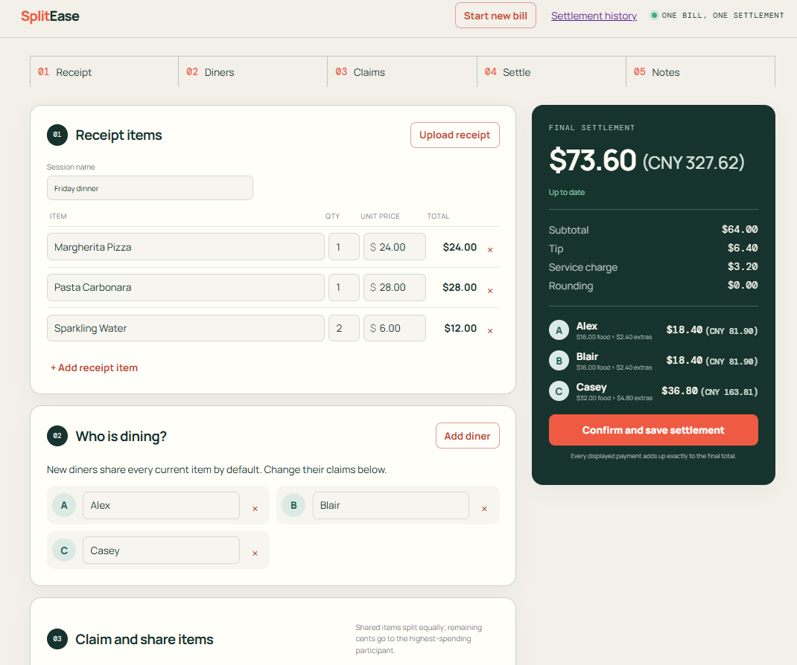
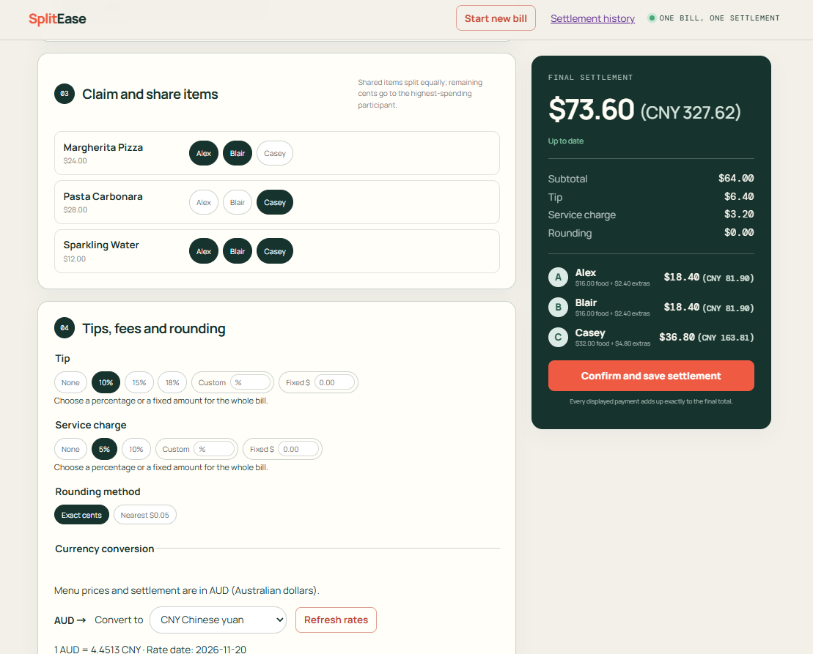
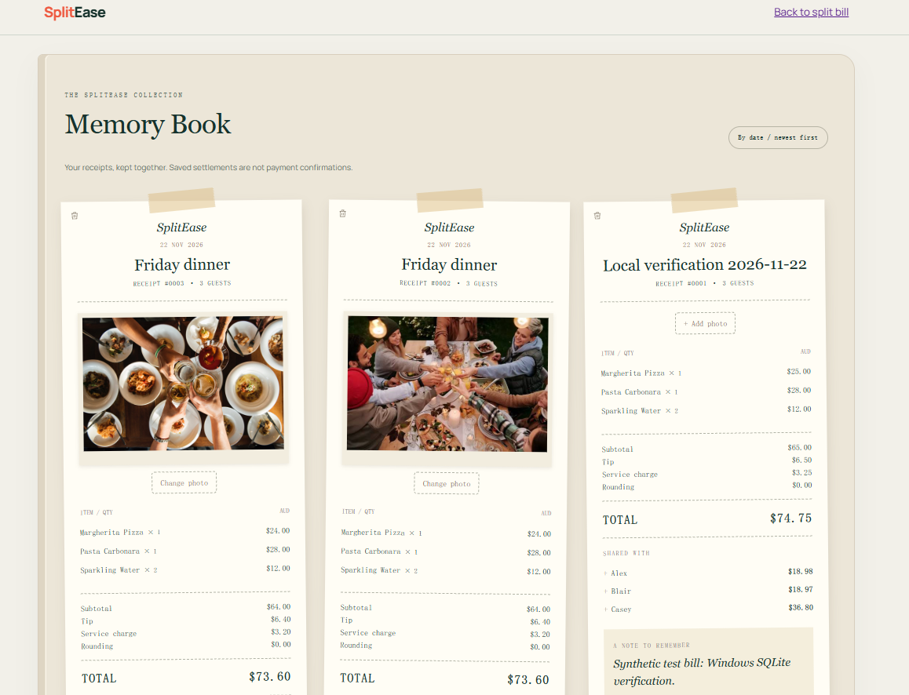

# SplitEase

**一张账单，清楚分摊，留下聚餐回忆。**

[English](README.md) | 简体中文

SplitEase 是一个聚餐分账工具：录入菜品、选择参与者、设置小费与服务费，即可计算每个人应付的金额。保存后的账单以 Memory Book 的形式展示，还可以添加照片和备注。

当前提供 Windows x64 本地便携版，采用 React + FastAPI + SQLite。EXE 已包含运行所需的 Python 环境和前端文件，使用者无需安装 Python、Node.js 或数据库服务。界面在系统浏览器中打开。

> Windows 下载：[最新版本](https://github.com/BenjaminW5/split_easy/releases/latest)。下载便携 ZIP，解压后双击 SplitEase.exe。

## 界面预览

### 账单编辑与实时分账

编辑菜品名称、数量、单价和用餐者，右侧自动显示总额与个人应付金额。



### 菜品认领、小费与服务费

为每道菜选择参与者；支持按比例或固定金额设置费用，并选择精确到分或最接近 0.05 澳元的取整方式。



### Memory Book 历史账单

查看已保存的菜品、费用、个人分摊和备注，为聚餐添加照片。



截图展示的是演示账单；汇率与换算金额仅代表截图时的显示结果。

## 功能

- **菜品管理**：添加、编辑和删除菜品，设置数量与单价。
- **参与者管理**：添加、重命名和移除用餐者。
- **按菜品分摊**：选择每道菜由谁承担，支持多人共享。
- **费用计算**：百分比或固定金额的小费、服务费，以及现金取整。
- **实时汇总**：展示每个人的餐费、附加费用和最终应付金额。
- **历史与照片**：保存账单、备注及附加照片，浏览或删除历史记录。
- **参考汇率**：以 AUD 为基础，显示 CNY、USD、EUR、JPY 或 KRW 的参考换算。
- **本地存储**：使用 SQLite 保存账单，不需要登录账号。

## Windows 便携版使用

1. 获取本地交付的 `SplitEase-Windows-x64.zip` 并解压，或直接使用 `SplitEase.exe`。
2. 双击 `SplitEase.exe`，等待启动，系统浏览器会自动打开界面。
3. 保持程序运行窗口开启，在浏览器中操作。
4. 使用完毕后关闭运行窗口，停止本机服务。只关闭浏览器标签不会停止程序。

程序仅监听 `127.0.0.1`，自动选择可用端口，无需手动启动后端或 Vite。请避免同时启动多个实例。

如果浏览器没有自动打开，可复制运行窗口中显示的网址；最近一次启动地址也记录在 `%LOCALAPPDATA%\SplitEase\last-url.txt`。

### 创建一笔分账

1. 点击 **Start new bill**，确认清空当前编辑内容；已保存记录会保留。
2. 添加用餐者，输入账单名称与菜品。
3. 在 **Claim and share items** 中选择每道菜的参与者。每道菜至少需要一名参与者。
4. 设置小费、服务费和取整方式，查看右侧实时结果。
5. 按需填写备注，点击 **Confirm and save settlement**。
6. 从 **Settlement history** 打开 Memory Book，查看结果并添加聚餐照片。

新增参与者默认参与所有已有菜品，可在认领区域修改。刷新页面会重置尚未保存的编辑内容。

## 数据与备份

便携版默认数据库位置：

```text
%LOCALAPPDATA%\SplitEase\splitease.db
```

关闭程序后复制该文件即可备份。替换 EXE 不会自动删除账单。恢复前应关闭程序并保留原数据库备份，再将备份放回同一位置。

源码开发模式的启动脚本使用 `backend/splitease.db`，与 EXE 的默认数据目录不同，不会自动迁移旧账单。

## 当前限制

- **OCR 默认为模拟模式**：上传图片会返回固定样例菜品，并非图片的真实识别结果。真实 OCR 需配置 `OCR_PROVIDER=ocrspace` 与 `OCR_SPACE_API_KEY`，并联网使用；本次未验证真实 OCR。
- **汇率是参考值**：联网获取，账单和保存金额仍以 AUD 为准。核心分账与保存不依赖汇率服务。
- **保存不等于支付**：软件记录分摊结果，不处理转账，也不确认实际付款。
- **单机模式**：当前不提供跨设备同步或多人在线协作。
- **未签名的测试版本**：Windows 可能显示未知发布者提示。已在当前 Windows 电脑测试，尚未在另一台纯净 Windows 电脑上验证。

## 开发与本地启动

源码运行需要 Python 3.12 和 Node.js/npm。实测环境为 Python 3.12.14、Node.js 24.22.0、npm 11.19.1。项目仍声明 Node.js 20.18.1，因此本机安装会出现版本提示；本次构建和测试通过。

在项目根目录的 PowerShell 中首次安装：

```powershell
cd backend
python -m venv .venv
.\.venv\Scripts\python.exe -m pip install -r requirements-dev.txt
cd ..\frontend
npm.cmd ci
cd ..
```

分别在两个终端中运行：

```powershell
.\start-backend.cmd
```

```powershell
.\start-frontend.cmd
```

开发界面：<http://127.0.0.1:5173>；后端健康检查：<http://127.0.0.1:8000/health>。

后端入口为 `app.local:app`，前端使用 `VITE_LOCAL_MODE=true`。更详细的 Windows 命令见 [本地运行说明](README_LOCAL.md)。

## 构建 EXE

完成上述依赖安装后，在项目根目录执行：

```powershell
.\build-windows.cmd
```

脚本构建同源访问 API 的本地模式前端，并使用 PyInstaller 打包 Python 后端与静态资源。当前脚本将 `SplitEase.exe` 输出到项目根目录的上一级目录，构建中间文件放在项目根目录上两级的 `work/pyinstaller` 中。

## 验证情况

2026-11-22 的本机验证结果：

| 检查 | 结果 |
| --- | --- |
| 后端本地模式与相关逻辑测试 | 182 项通过；不代表 PostgreSQL 完整版集成测试通过 |
| 前端测试 | 25 个测试文件，188 项通过 |
| 前端构建 | TypeScript 检查与 Vite 构建通过 |
| 开发模式联调 | 9 组真实 HTTP 检查通过；浏览器编辑、计算、保存及重启持久化通过 |
| EXE 独立启动 | 在 PATH 不包含 Python/Node 的子进程中启动成功 |
| EXE 功能检查 | 健康接口、内置前端 HTML、保存与重启读取通过 |

上述 EXE 测试仍在已安装开发工具的同一台电脑上执行，不等同于独立纯净系统兼容性测试。

## 技术组成

| 部分 | 技术 |
| --- | --- |
| 界面 | React、TypeScript、Vite |
| API | FastAPI、Uvicorn |
| 本地数据 | SQLite |
| Windows 打包 | PyInstaller，单文件 EXE |
| 显示方式 | 系统浏览器 |

本说明针对 SplitEase/BREAD 的 SQLite 本地版本。

